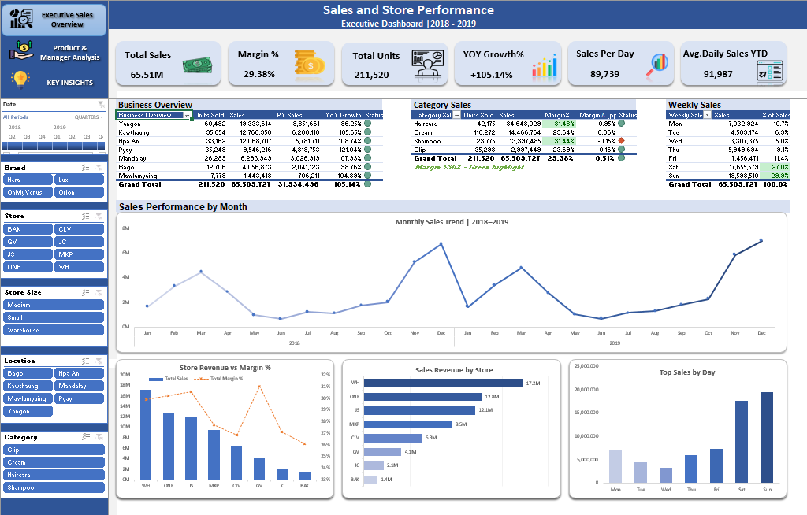
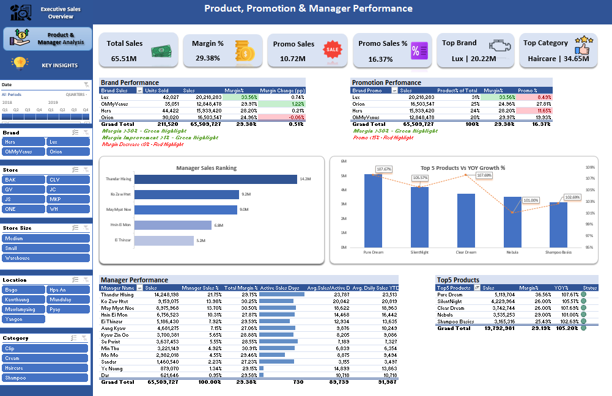
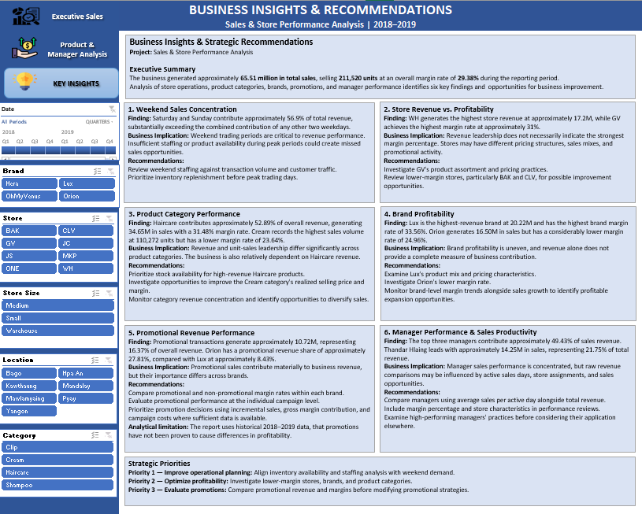

# 📊 Sales & Store Performance Analysis | Excel Portfolio Project

### Power Query | Power Pivot | DAX | PivotTables | Interactive Dashboards

## 📌 Project Overview

This project analyzes retail sales performance across stores, product categories, brands, promotions, and managers using Microsoft Excel.

The objective is to transform transactional sales data into an interactive business intelligence solution that helps identify revenue drivers, profitability differences, sales trends, and opportunities for operational improvement.

The project demonstrates an end-to-end Excel data analytics workflow, including data preparation, relational data modeling, DAX calculations, dashboard development, and business insights.

**Analysis Period:** January 2018 – December 2019  
**Primary Tool:** Microsoft Excel  
**Methods:** Power Query, Power Pivot, DAX, PivotTables, PivotCharts, Slicers, and Timelines

---

## 🎯 Business Objectives

The analysis addresses six key business questions:

1. How does overall sales performance change over time?
2. Which stores generate the highest revenue and profit margins?
3. Which product categories and brands contribute most to revenue?
4. How significant are promotional transactions to overall sales?
5. How does manager sales performance differ across stores?
6. What business actions can be recommended based on these findings?

---

## 🛠️ Tools & Technical Skills

| Tool / Feature | Application |
|---|---|
| Microsoft Excel | Dashboard development and reporting |
| Power Query | Data import, cleaning, and transformation |
| Power Pivot | Relational data modeling |
| DAX | KPI and business measure calculations |
| PivotTables | Multidimensional sales analysis |
| PivotCharts | Performance visualization |
| Slicers & Timeline | Interactive filtering |
| Excel Formulas | Dynamic KPI displays and report formatting |

---

## 🗂️ Data Model

The project uses a Power Pivot Data Model with a central sales fact table and supporting lookup tables.

**Main tables:**

- `SalesRaw` — Transaction-level sales data
- `Dim_Date` — Calendar and reporting-period attributes
- `Dim_Products` — Product, brand, and category information
- `Dim_Stores` — Store characteristics and locations
- `ManagerListTable` — Manager reference information
- `CommissionTable` — Service-year commission lookup

Relationships connect sales transactions with the relevant dimension tables, enabling consistent analysis across reporting categories.

The manager and commission data are also incorporated into the model using Power Query.

---

## 📈 Dashboard 1: Executive Sales & Store Performance


  

This interactive dashboard provides an overview of sales performance, profitability, and store operations.

**Key features:**

- Total Sales, Units Sold, and Margin %
- Average Daily Sales and YTD Average Daily Sales
- Monthly Sales Trend
- Store Revenue Ranking
- Store Revenue vs. Margin %
- Weekly Sales Performance
- Location and Category Performance
- Interactive slicers and timeline

**Purpose:** Help management monitor overall sales performance and identify differences in store profitability.

---

## 📊 Dashboard 2: Product, Promotion & Manager Performance


  

This dashboard provides a more detailed view of the business's revenue drivers and operational performance.

**Key features:**

- Top Revenue-Generating Category and Brand
- Promotional Sales and Revenue Contribution
- Category and Brand Profitability
- Brand Promotional Performance
- Top 5 Product Analysis
- Manager Sales Ranking and Productivity
- Interactive reporting filters

**Purpose:** Identify product and brand performance differences, evaluate promotional sales contribution, and compare manager productivity.

---

## 💡 Key Business Insights


  

The following findings are based on the full-period analysis covering 2018–2019.

### 1. Weekend Sales Concentration

Saturday and Sunday account for approximately **56.9% of total revenue**.

**Recommendation:** Investigate weekend staffing and inventory requirements to better align operational resources with peak trading periods.

### 2. Product Category Performance

Haircare contributes approximately **52.89% of total revenue**, generating around **34.65M in sales**, with a **31.48% margin rate**.

**Recommendation:** Prioritize stock availability for high-performing products while monitoring category revenue concentration.

### 3. Brand Profitability

Lux leads brand revenue with approximately **20.22M in sales** and achieves the highest brand margin rate of **33.56%**.

**Recommendation:** Examine differences in pricing, product mix, and promotional activity across brands to identify profitability opportunities.

### 4. Promotional Sales Contribution

Promotional transactions account for approximately **16.37% of total sales revenue**.

Promotional revenue contribution varies between brands, highlighting the importance of evaluating promotion strategies separately.

**Recommendation:** Compare promotional and non-promotional margins before adjusting campaign strategies.

### 5. Store Revenue vs. Profitability

The highest-revenue store is not necessarily the store with the highest margin percentage.

**Recommendation:** Evaluate store performance using both revenue and profitability measures rather than sales volume alone.

### 6. Manager Sales Performance

The top three managers contribute approximately **49.43% of overall sales**.

**Recommendation:** Compare manager revenue alongside active sales days, margin percentage, and store assignments to support more balanced performance evaluation.

---

## 📁 Project Structure

The repository is organized around the completed Excel workbook, dashboard screenshots, and supporting documentation.

```text
excel-sales-store-performance-analysis/
│
├── README.md
│
├── Sales_Store_Performance_Analysis.xlsx
│
├── screenshots/
│   ├── executive-sales-dashboard.png
│   ├── product-manager-dashboard.png
│   ├── business-insights.png
│   └── data-model.png
│
└── docs/
    ├── business-insights.md
    └── dax-measures.md
```

---

## 🔎 Analytical Limitations

- The analysis uses historical sales data from 2018–2019.
- Findings reflect the selected reporting context and should be interpreted accordingly.
- Promotional sales patterns do not establish causal effects on profitability.
- Manager sales comparisons may be influenced by store assignment and active selling days.
- Refreshing the workbook may require access to the original Power Query data sources.

---

## 📚 Project Outcomes

Through this project, I strengthened my ability to:

- Build and manage relational data models in Excel.
- Create reusable DAX measures for business reporting.
- Develop interactive dashboards with PivotTables, charts, slicers, and timelines.
- Analyze sales, product, store, and manager performance.
- Communicate data-driven findings and actionable business recommendations.

The project demonstrates how Excel can be used as a business intelligence and decision-support tool beyond traditional spreadsheet reporting.

---

## 📥 Download the Excel Dashboard

[**Download the Excel Portfolio Workbook**](Sales_Store_Performance_Analysis.zip)

> **Note:** Open the workbook in Microsoft Excel Desktop for the full Power Pivot, slicer, timeline, and interactive dashboard experience. Refreshing Power Query connections may require access to the original source files.

## 📬 Feedback

Feedback and suggestions from data professionals, analysts, and recruiters are welcome.

*Built with Microsoft Excel, Power Query, Power Pivot, and DAX.*
